<p align="center"></p>

# Editor Binario

Ejercicio final de la unidad 1: programa Java que trabaja con un fichero binario.

## 📁 Contenido

- `pom.xml`
- `src/`

## 🚀 Ejecución

```bash
mvn -q package
```
