<p align="center"></p>

# 🗄️ Acceso a Datos

**Trabajo con ficheros en Java: acceso aleatorio a binarios, copia de ficheros y excepciones propias.**

## 🗂️ Contenido

| Proyecto | Qué trabaja |
|---|---|
| [`Editor_Binario`](Editor_Binario) | Edita un fichero binario de enteros con `RandomAccessFile`: lo inicializa con 10 números, lo muestra por posición y sustituye el número de la posición que indique el usuario. Incluye excepciones propias (`MyFileNotFoundException`, `MyPointerIsNullException`, `MyPointerOutOfBoundException`) y utilidades de entrada. |
| [`Make_a_Duplicate_Image`](Make_a_Duplicate_Image) | Duplica una imagen leyendo sus bytes con `Files.readAllBytes` y escribiendo la copia con prefijo `C_`. |

## 🚀 Ejecución

Necesitas **JDK 26** y **Maven**. Desde la carpeta de cada proyecto:

```bash
mvn -q package
java -cp target/classes app.Main
```

> Las rutas de los ficheros son relativas (`src/main/resources/…`), así que hay que ejecutar desde la carpeta del proyecto.

## 🧰 Tecnologías

- Java 26 · Maven
- `RandomAccessFile`, `java.nio.file`
