<p align="center"></p>

# Test Unit 1 · Crear fichero

Pruebas de la unidad 1: creación y manejo de ficheros en Java.

## 📁 Contenido

- `pom.xml`
- `src/`

## 🚀 Ejecución

```bash
mvn -q package
```
