<p align="center"></p>

# Práctica Constraint Layout

Práctica guiada de diseño de interfaz con ConstraintLayout en Android.

## 📁 Contenido

- `app/`
- `build.gradle.kts`
- `gradle/`
- `gradle.properties`
- `gradlew`
- `gradlew.bat`
- `local.properties`
- `settings.gradle.kts`

## 🚀 Ejecución

```bash
./gradlew assembleDebug
```
