<p align="center"></p>

# 📱 Desarrollo de Aplicaciones Móviles

**Primeros pasos con Kotlin y Android Studio.**

## 🗂️ Contenido

| Carpeta | Qué contiene |
|---|---|
| [`IniciacionAKotlin`](IniciacionAKotlin) | Primer contacto con Kotlin: un proyecto Maven con una función `main` y una función `sumar`. |
| [`Entorno_Movil`](Entorno_Movil) | Trabajo 1: informe en LaTeX (29 páginas) sobre la instalación y puesta en marcha de Android Studio, con capturas. El resultado es [`Trabajo1EntornosMoviles.pdf`](Entorno_Movil/Trabajo1EntornosMoviles.pdf). |

## 🚀 Ejecución

**Kotlin:** necesitas **JDK** y **Maven**. Desde `IniciacionAKotlin`:

```bash
mvn -q compile
```

**Informe:** necesitas una distribución de LaTeX con `latexmk` y `make`. Desde `Entorno_Movil`:

```bash
make compilar   # genera el PDF
make abrir      # lo abre
make limpiar    # borra los ficheros auxiliares
```

El texto está dividido en secciones dentro de `_partes/`, y `PENDIENTES.md` recoge lo que falta por completar.

## 🧰 Tecnologías

- Kotlin · Maven
- LaTeX (`latexmk`, `xelatex`)
