<p align="center"></p>

# 🖥️ Desarrollo de Interfaces

**Del primer programa en C# a aplicaciones con interfaz gráfica (WPF) y de terminal (TUI).**

## 🗂️ Contenido

| Carpeta | Qué contiene |
|---|---|
| [`EjerciciosPresentacion`](EjerciciosPresentacion) | Primer programa, instalación del entorno, estructura sintáctica, mensaje personalizado, variables y tipos de datos. |
| [`EjerciciosClase`](EjerciciosClase) | Primer programa, cálculo de áreas, día de la semana y programación orientada a objetos con vehículos. |
| [`UD0-Introduccion_a_Csharp/01_CasoPractico_MathGame`](UD0-Introduccion_a_Csharp/01_CasoPractico_MathGame) | 🧮 Juego de matemáticas por consola con historial y estadísticas. |
| [`UD0-Introduccion_a_Csharp/02_CasoPractico_HabitLogger`](UD0-Introduccion_a_Csharp/02_CasoPractico_HabitLogger) | 📝 Registro de hábitos con SQLite, en versión [consola](UD0-Introduccion_a_Csharp/02_CasoPractico_HabitLogger/HabitLogger) y [TUI](UD0-Introduccion_a_Csharp/02_CasoPractico_HabitLogger/HabitLoggerTui). |
| [`UD01_Confeccion_de_interfaces/Calculadora`](UD01_Confeccion_de_interfaces/Calculadora) | 🧮 Calculadora de escritorio en WPF y XAML. |
| [`UD01_Confeccion_de_interfaces/Guia_Estilos_Ryoku_Kami.pdf`](UD01_Confeccion_de_interfaces/Guia_Estilos_Ryoku_Kami.pdf) | Guía de estilos visual. |

## 🚀 Ejecución

Necesitas el **SDK de .NET 10**. Cada proyecto se ejecuta desde su carpeta con:

```bash
dotnet run --project <proyecto>
```

Los proyectos de las carpetas `EjerciciosClase` y `EjerciciosPresentacion` están en subcarpetas con su `.csproj`.

## 🧰 Tecnologías

- C# / .NET 10
- WPF y XAML ([LibreWPF](UD01_Confeccion_de_interfaces/Calculadora/README.md) para ejecutarlo en Linux)
- SQLite con `Microsoft.Data.Sqlite` · Ratatui.cs para la TUI
