<p align="center"></p>

# 🖥️ Desarrollo de Interfaces

**Del primer programa en C# a aplicaciones con interfaz gráfica (WPF) y de terminal (TUI).**

## 🗂️ Contenido

| Carpeta | Qué contiene |
|---|---|
| [`UD00_Introduccion_a_Csharp/Ejercicios_Presentacion`](UD00_Introduccion_a_Csharp/Ejercicios_Presentacion) | Ejercicios de la presentación de la UD00: del primer programa al proyecto integrador (agenda de contactos). Incluye los ejercicios 01–05 y 08–15 de la presentación (el 06 y el 07 no existen en el PDF). |
| [`UD01_Confeccion_de_interfaces/Ejercicios_Presentacion`](UD01_Confeccion_de_interfaces/Ejercicios_Presentacion) | Actividades de la presentación de la UD01: [1.3](UD01_Confeccion_de_interfaces/Ejercicios_Presentacion/08_Actividad_1_3_Laboratorio_Usabilidad) (usabilidad) y las 2.2, 2.4, 2.5 (A y B), 2.7, 2.8 y 2.9 en WPF. Las actividades 1.1, 1.2 y 1.4 son entregas ya hechas. |
| [`Ejercicios_Clase`](UD00_Introduccion_a_Csharp/Ejercicios_Clase) | Primer programa, cálculo de áreas, día de la semana y programación orientada a objetos con vehículos. |
| [`UD00_Introduccion_a_Csharp/Casos_Practicos/01_Math_Game`](UD00_Introduccion_a_Csharp/Casos_Practicos/01_Math_Game) | 🧮 Juego de matemáticas por consola con historial y estadísticas. |
| [`UD00_Introduccion_a_Csharp/Casos_Practicos/02_Habit_Logger`](UD00_Introduccion_a_Csharp/Casos_Practicos/02_Habit_Logger) | 📝 Registro de hábitos con SQLite, en versión [consola](UD00_Introduccion_a_Csharp/Casos_Practicos/02_Habit_Logger/HabitLogger) y [TUI](UD00_Introduccion_a_Csharp/Casos_Practicos/02_Habit_Logger/HabitLoggerTui). |
| [`UD01_Confeccion_de_interfaces/Casos_Practicos/01_Calculadora`](UD01_Confeccion_de_interfaces/Casos_Practicos/01_Calculadora) | 🧮 Calculadora de escritorio en WPF y XAML. |
| [`UD01_Confeccion_de_interfaces/Guia_Estilos_Ryoku_Kami.pdf`](UD01_Confeccion_de_interfaces/Guia_Estilos_Ryoku_Kami.pdf) | Guía de estilos visual. |

## 🚀 Ejecución

Necesitas el **SDK de .NET 10**. Cada proyecto se ejecuta desde su carpeta con:

```bash
dotnet run --project <proyecto>
```

Los proyectos de las carpetas `Ejercicios_Clase` y `Ejercicios_Presentacion` están en subcarpetas con su `.csproj`.

## 🧰 Tecnologías

- C# / .NET 10
- WPF y XAML ([LibreWPF](UD01_Confeccion_de_interfaces/Casos_Practicos/01_Calculadora/README.md) para ejecutarlo en Linux)
- SQLite con `Microsoft.Data.Sqlite` · Ratatui.cs para la TUI
