<p align="center"></p>

# Calcular día de la semana

Ejercicio de clase de la UD00.

## 📁 Contenido

- `CalcularDiaSemana/`
- `CalcularDiaSemana.slnx`

## 🚀 Ejecución

```bash
dotnet run --project CalcularDiaSemana
```
