<p align="center"></p>

# POO · Vehículos

Ejercicio de clase de la UD00: programación orientada a objetos.

## 📁 Contenido

- `Vehiculos/`
- `Vehiculos.slnx`

## 🚀 Ejecución

```bash
dotnet run
```
