<p align="center"></p>

# Calculadora de edad futura

**Ejercicio 03** de la presentación de la UD00 (Introducción a C# y .NET).

## 📝 Enunciado

Solicitar la edad actual del usuario mediante la consola.

**Requisitos:** Parsear la entrada a entero con `int.Parse()` e imprimir la edad calculada dentro de 10 años.

## 📁 Contenido

- `CalculadoraEdadFutura/CalculadoraEdadFutura.csproj`
- `CalculadoraEdadFutura/Ejercicio03.cs`

## 🚀 Ejecución

Necesitas el **SDK de .NET 10**.

```bash
dotnet run --project CalculadoraEdadFutura
```


**Entrada de ejemplo:** `20`

## 🧪 Salida

```text
Tu edad actual: En 10 anios tendras 30
```
