<p align="center"></p>

# Número par o impar

**Ejercicio 04** de la presentación de la UD00 (Introducción a C# y .NET).

## 📝 Enunciado

Solicitar un número entero por teclado.

**Requisitos:** Calcular el residuo de la división entre 2 con el operador `%` e informar si es Par o Impar.

## 📁 Contenido

- `NumeroParOImpar/Ejercicio04.cs`
- `NumeroParOImpar/NumeroParOImpar.csproj`

## 🚀 Ejecución

Necesitas el **SDK de .NET 10**.

```bash
dotnet run --project NumeroParOImpar
```


**Entrada de ejemplo:** `7`

## 🧪 Salida

```text
Numero: IMPAR
```
