<p align="center"></p>

# Validación de contraseña

**Ejercicio 05** de la presentación de la UD00 (Introducción a C# y .NET).

## 📝 Enunciado

Solicitar una clave secreta por teclado.

**Requisitos:** Utilizar un bucle `do-while` para pedir la clave repetidamente hasta acertar (`"1234"`).

## 📁 Contenido

- `ValidacionContrasena/Ejercicio05.cs`
- `ValidacionContrasena/ValidacionContrasena.csproj`

## 🚀 Ejecución

Necesitas el **SDK de .NET 10**.

```bash
dotnet run --project ValidacionContrasena
```


**Entrada de ejemplo:** `abc ⏎ 0000 ⏎ 1234`

## 🧪 Salida

```text
Clave: Clave: Clave: Acceso Concedido!
```
