<p align="center"></p>

# Producto encapsulado

**Ejercicio 08** de la presentación de la UD00 (Introducción a C# y .NET).

## 📝 Enunciado

Diseñar la clase `Producto` con atributo `precio` privado y método de acceso validado.

**Requisitos:** Garantizar en `SetPrecio()` que el valor no sea negativo antes de asignarlo.

## 📁 Contenido

- `ProductoEncapsulado/Ejercicio08.cs`
- `ProductoEncapsulado/ProductoEncapsulado.csproj`

## 🚀 Ejecución

Necesitas el **SDK de .NET 10**.

```bash
dotnet run --project ProductoEncapsulado
```


## 🧪 Salida

```text
SetPrecio(25,50) -> True
Precio actual: 25,50 €
SetPrecio(-5) -> False
Precio actual (sin cambios): 25,50 €
```
