<p align="center"></p>

# Área de figuras

**Ejercicio 10** de la presentación de la UD00 (Introducción a C# y .NET).

## 📝 Enunciado

Diseñar la clase `CalculadoraArea` con métodos sobrecargados `Calcular()`.

**Requisitos:** Sobrecargar para calcular el área de un Cuadrado (`double lado`) y de un Rectángulo (`double b, double h`).

## 📁 Contenido

- `AreaDeFiguras/AreaDeFiguras.csproj`
- `AreaDeFiguras/Ejercicio10.cs`

## 🚀 Ejecución

Necesitas el **SDK de .NET 10**.

```bash
dotnet run --project AreaDeFiguras
```


## 🧪 Salida

```text
25
24
```
