<p align="center"></p>

# Instrumentos musicales

**Ejercicio 11** de la presentación de la UD00 (Introducción a C# y .NET).

## 📝 Enunciado

Crear la clase base `Instrumento` con método virtual `Tocar()` y subclases `Guitarra` y `Piano`.

**Requisitos:** Sobrescribir el método `Tocar()` en cada subclase y ejecutarlos mediante referencias de la clase base.

## 📁 Contenido

- `InstrumentosMusicales/Ejercicio11.cs`
- `InstrumentosMusicales/InstrumentosMusicales.csproj`

## 🚀 Ejecución

Necesitas el **SDK de .NET 10**.

```bash
dotnet run --project InstrumentosMusicales
```


## 🧪 Salida

```text
Suena la guitarra
Suena el piano
```
