<p align="center"></p>

# Notificaciones polimórficas

**Ejercicio 12** de la presentación de la UD00 (Introducción a C# y .NET).

## 📝 Enunciado

Diseñar un sistema de notificaciones polimórfico usando interfaces (en 3 pasos).

**Requisitos:** Paso 1: interfaz `INotificable` (`Destinatario` y `Enviar()`) y `EmailNotificador`. Paso 2: `SmsNotificador` y `PushNotificador`. Paso 3: una `List<INotificable>` en `Main()` ejecutada polimórficamente.

## 📁 Contenido

- `Notificaciones/Ejercicio12.cs`
- `Notificaciones/INotificable.cs`
- `Notificaciones/Notificaciones.csproj`
- `Notificaciones/NotificadoresConcretos.cs`

## 🚀 Ejecución

Necesitas el **SDK de .NET 10**.

```bash
dotnet run --project Notificaciones
```


## 🧪 Salida

```text
Email a a@a.com: Alerta!
SMS a 600112233: Alerta!
Push a Usr_99: Alerta!
```
