<p align="center"></p>

# Lectura segura de números

**Ejercicio 15** de la presentación de la UD00 (Introducción a C# y .NET).

## 📝 Enunciado

Crear la función `LeerEntero()` protegida con un bloque `try-catch`.

**Requisitos:** Solicitar un número repetidamente al usuario por consola hasta que introduzca un entero válido.

## 📁 Contenido

- `LecturaSeguraNumeros/Ejercicio15.cs`
- `LecturaSeguraNumeros/LecturaSeguraNumeros.csproj`

## 🚀 Ejecución

Necesitas el **SDK de .NET 10**.

```bash
dotnet run --project LecturaSeguraNumeros
```


**Entrada de ejemplo:** `hola ⏎ 3.5 ⏎ 42`

## 🧪 Salida

```text
Introduce un numero entero: Reintenta: Reintenta: Has introducido: 42
```
