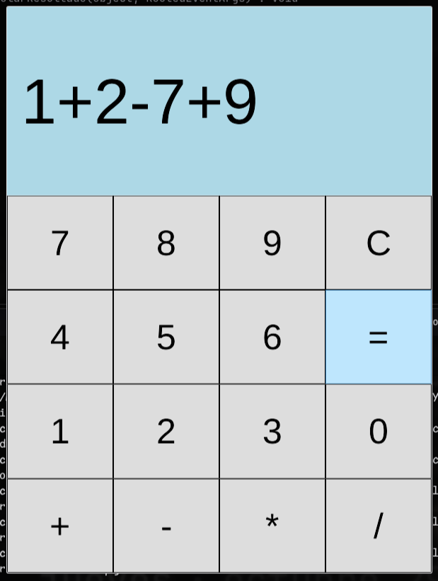
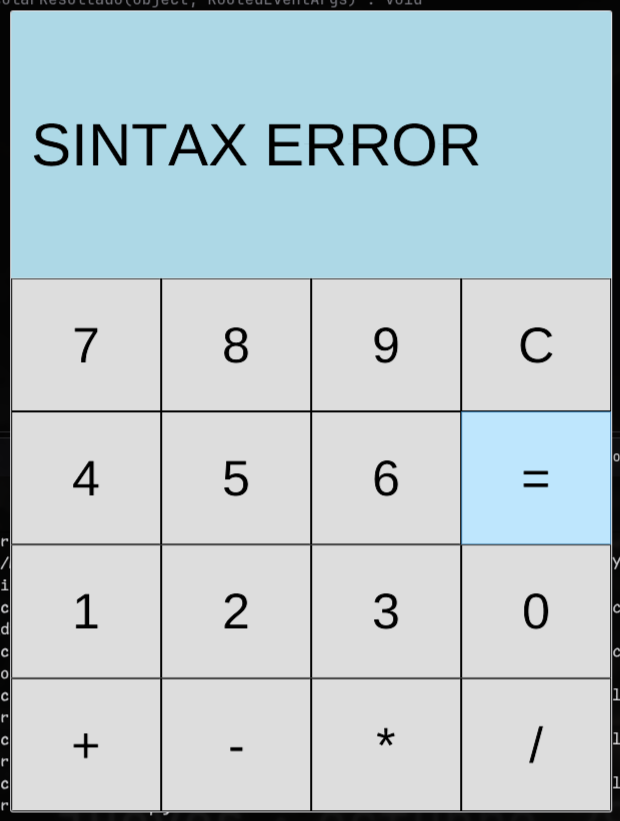

<p align="center"></p>

# 🧮 Calculadora

**Calculadora de escritorio con interfaz WPF escrita en C#.**

Primera práctica de la unidad *Confección de interfaces*: una ventana con una pantalla y un teclado de 16 botones, maquetada en XAML con `Grid` y con la lógica de los botones en *code-behind*. Escribes una operación completa (por ejemplo `12+7*3`) y al pulsar `=` se evalúa.

## ✨ Funciones

- Suma, resta, multiplicación y división de números enteros.
- Operaciones encadenadas con varios operadores (`8+4-2*3`).
- Botón `C` para borrar la pantalla y volver a `0`.
- Control de errores: una operación mal formada o una división entre cero muestra `SINTAX ERROR` en lugar de cerrar la aplicación.

## 🚀 Ejecución

Necesitas tener instalado el **SDK de .NET 10**.

```bash
dotnet run --project Calculadora
```

> 🐧 El proyecto usa [LibreWPF](Calculadora.csproj) (`LibreWPF.Sdk`, versión *preview*), una reimplementación multiplataforma de WPF, para poder compilarlo y ejecutarlo en Linux.
>
> 🪟 Para ejecutarlo con WPF nativo en Windows, cambia en `Calculadora.csproj` el atributo `Sdk` por el SDK estándar: `<Project Sdk="Microsoft.NET.Sdk">`. El XAML y el C# no cambian.

## 🖼️ Interfaz

La ventana (600 × 800) se divide en dos filas con un `Grid`: la pantalla ocupa 1/3 de la altura y el teclado los otros 2/3. El teclado es otro `Grid` de 4 × 4 celdas iguales.

```text
┌───────────────────────────┐
│                         0 │  ← ResultadoFinal (fondo azul claro)
├─────┬─────┬─────┬─────────┤
│  7  │  8  │  9  │    C    │
├─────┼─────┼─────┼─────────┤
│  4  │  5  │  6  │    =    │
├─────┼─────┼─────┼─────────┤
│  1  │  2  │  3  │    0    │
├─────┼─────┼─────┼─────────┤
│  +  │  -  │  *  │    /    │
└─────┴─────┴─────┴─────────┘
```

### 📸 Capturas

| Operación escrita en pantalla | Error de sintaxis |
|---|---|
|  |  |

## ⚙️ Cómo funciona

Todos los botones comparten pocos manejadores de eventos, y el botón que se ha pulsado se identifica por su `Content`:

| Manejador | Botones | Qué hace |
|---|---|---|
| `AgregarNumero` | `0`–`9` | Añade el dígito a la pantalla. El primer dígito sustituye al `0` inicial. |
| `AgregarSigno` | `+` `-` `*` `/` | Añade el operador a la pantalla. |
| `LimpiarPantalla` | `C` | Restablece la pantalla a `0`. |
| `CalcularResultado` | `=` | Evalúa la operación escrita y muestra el resultado. |

**Evaluación (`CalcularResultado`):**

1. Se divide el texto con una expresión regular (`([+\-*/])`) en números y operadores alternados.
2. Cada número se convierte con `int.TryParse`; si alguno falla, hay error.
3. Se comprueba que haya exactamente un operador menos que números.
4. Se aplican las operaciones de izquierda a derecha, acumulando el resultado en el siguiente número.
5. Si no hubo error se muestra el resultado; si lo hubo, se muestra `SINTAX ERROR`.

## ⚠️ Limitaciones conocidas

- **Sin precedencia de operadores:** se evalúa estrictamente de izquierda a derecha, así que `2+3*4` da `20` y no `14`.
- **Solo enteros:** no hay coma decimal y la división es entera (`7/2` da `3`). Tampoco se controla el desbordamiento de `int`.
- **Sin números negativos como entrada:** un `-` inicial (o dos operadores seguidos) se considera sintaxis incorrecta.
- Tras un error, la fuente de la pantalla se queda en tamaño 60 y no se restablece con `C`.

## 🗂️ Estructura

| Archivo | Responsabilidad |
|---|---|
| `App.xaml` | Punto de entrada de la aplicación; arranca `MainWindow.xaml` |
| `MainWindow.xaml` | Diseño de la ventana: pantalla y teclado |
| `MainWindow.xaml.cs` | Lógica de los botones y evaluación de la operación |
| `Calculadora.csproj` | Configuración del proyecto (.NET 10, WPF, LibreWPF) |

## 🧰 Tecnologías

- C# / .NET 10
- WPF y XAML (`Grid`, `TextBlock`, `Button`)
- [LibreWPF](Calculadora.csproj) para ejecutarlo en Linux
