<p align="center"></p>
# 📅 Registro de hábitos

Aplicación de escritorio WPF (C#) que guarda hábitos en una base de datos **SQLite local** y los muestra en una tabla. Aplica lo visto en *UD01 – Parte 2*: MVVM con `CommunityToolkit.Mvvm`, `ObservableCollection`, `ICollectionView` (filtro), `DataGrid` y comandos con `CanExecute`, sin manejadores de eventos en la ventana.

## ✨ Funciones

- Añadir un hábito (nombre + descripción).
- Marcar o deshacer «hecho hoy» sobre el hábito seleccionado.
- La tabla muestra hábito, descripción, si está hecho hoy, **racha** (días seguidos) y total de registros.
- Buscar por nombre mientras se escribe.
- Eliminar un hábito (sus registros se borran en cascada).
- Barra de estado: nº de hábitos y completados hoy.

## 🚀 Ejecución

```bash
dotnet run
```

> 🐧 Usa `LibreWPF.Sdk` (preview) para ejecutarse en Linux. En Windows cambia el `Sdk` de `gui_bbdd.csproj` por `Microsoft.NET.Sdk`.

## 🗄️ Base de datos

Fichero `habitos.db` en `~/.local/share/gui_bbdd/` (Linux) o `%LocalAppData%\gui_bbdd\` (Windows); se crea solo al arrancar.

```text
habitos   (id PK, nombre, descripcion)
registros (habito_id FK → habitos ON DELETE CASCADE, fecha 'yyyy-MM-dd', PK(habito_id, fecha))
```

## 🧩 Estructura

| Archivo | Responsabilidad |
| --- | --- |
| `Models/Habito.cs` | Modelo observable (`HechoHoy`, `Racha`, `Total`) |
| `Data/HabitoRepositorio.cs` | Acceso a SQLite (Microsoft.Data.Sqlite) y cálculo de la racha |
| `ViewModels/MainViewModel.cs` | Lista, filtro, selección y comandos |
| `MainWindow.xaml` | Vista: solo `Binding` y `Command` |
