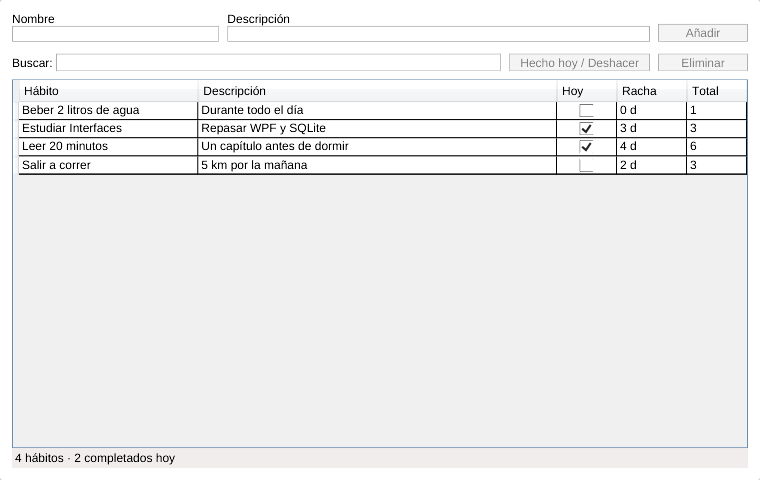
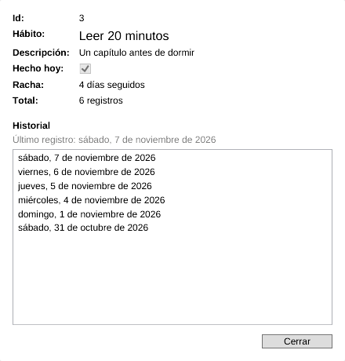

<p align="center"></p>

# 📅 Registro de hábitos (versión 2)

Segunda versión del [registro de hábitos](../02_GUI_BBDD): aplicación de escritorio WPF (C#) que guarda hábitos en una base de datos **SQLite local** y los muestra en una tabla. Esta versión prescinde de MVVM y resuelve la lógica en *code-behind* con manejadores de eventos, y añade una **ventana de detalle** con el historial de cada hábito.

## ✨ Funciones

- Añadir un hábito (nombre + descripción). El botón solo se activa si hay nombre.
- Marcar o deshacer «hecho hoy» sobre el hábito seleccionado.
- La tabla muestra hábito, descripción, si está hecho hoy, **racha** (días seguidos) y total de registros.
- Buscar por nombre mientras se escribe.
- Eliminar un hábito (sus registros se borran en cascada).
- **Nuevo:** doble clic en una fila para abrir el detalle del hábito, con su historial de días completados del más reciente al más antiguo.
- Barra de estado: nº de hábitos y completados hoy.

## 🚀 Ejecución

Necesitas el **SDK de .NET 10**.

```bash
dotnet run
```

> 🪟 El proyecto usa el SDK estándar (`Microsoft.NET.Sdk`), así que se ejecuta con WPF nativo en Windows.
>
> 🐧 Para ejecutarlo en Linux, cambia en `gui_bbdd.csproj` el atributo `Sdk` por `LibreWPF.Sdk/0.1.0-preview.45`, como en la [versión 1](../02_GUI_BBDD/gui_bbdd.csproj). El XAML y el C# no cambian.

## 🗄️ Base de datos

Fichero `habitos.db` en `%LocalAppData%\gui_bbdd\` (Windows) o `~/.local/share/gui_bbdd/` (Linux); se crea solo al arrancar. Es la misma ruta que usa la versión 1, así que ambas comparten los datos.

```text
habitos   (id PK, nombre, descripcion)
registros (habito_id FK → habitos ON DELETE CASCADE, fecha 'yyyy-MM-dd', PK(habito_id, fecha))
```

## 📸 Capturas

| Ventana principal | Detalle de un hábito |
|---|---|
|  |  |

## ⚙️ Cómo funciona

| Evento | Control | Qué hace |
|---|---|---|
| `txtNombre_TextChanged` | Campo *Nombre* | Activa *Añadir* si el nombre no está vacío. |
| `txtBuscar_TextChanged` | Buscador | Refresca el filtro del `ICollectionView`. |
| `dgHabitos_SelectionChanged` | `DataGrid` | Activa *Hecho hoy* y *Eliminar* si hay una fila seleccionada. |
| `btnAnadir_Click` | *Añadir* | Inserta el hábito en la BBDD y en la lista. |
| `btnHechoHoy_Click` | *Hecho hoy / Deshacer* | Añade o borra el registro de hoy y recalcula racha y total. |
| `btnEliminar_Click` | *Eliminar* | Borra el hábito (y en cascada sus registros). |
| `Fila_MouseDoubleClick` | Fila del `DataGrid` | Abre `DetalleWindow` como ventana modal (`ShowDialog`). |

El doble clic se engancha con un `EventSetter` en el `RowStyle` del `DataGrid`. La **racha** cuenta los días seguidos hasta hoy; si hoy aún no está hecho, empieza a contar desde ayer.

## 🧩 Estructura

| Archivo | Responsabilidad |
| --- | --- |
| `Models/Habito.cs` | Modelo del hábito (`HechoHoy`, `Racha`, `Total`) |
| `Data/HabitoRepositorio.cs` | Acceso a SQLite (Microsoft.Data.Sqlite), historial y cálculo de la racha |
| `MainWindow.xaml` / `.cs` | Ventana principal y manejadores de eventos |
| `DetalleWindow.xaml` / `.cs` | Ventana de detalle con el historial del hábito |
| `gui_bbdd.csproj` | Configuración del proyecto (.NET 10, WPF, SQLite) |

## 🧰 Tecnologías

- C# / .NET 10
- WPF y XAML (`DataGrid`, `ListBox`, `StatusBar`, `DockPanel`, `Grid`)
- SQLite con `Microsoft.Data.Sqlite`
