<p align="center"></p>

# Ficha de usuario con BBDD

Actividad 1.7: ficha de usuario con base de datos (WPF).

## 📁 Contenido

- `App.xaml`
- `Data/`
- `FichaUsuario_BBDD.csproj`
- `MainWindow.xaml`
- `MainWindow.xaml.cs`
- `Models/`

## 🚀 Ejecución

```bash
dotnet run
```
