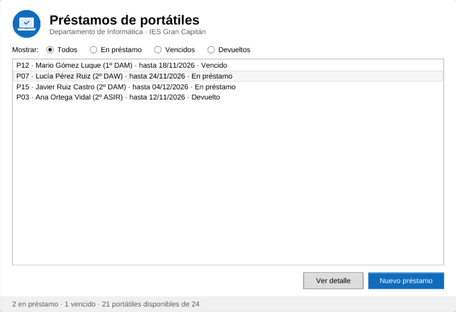
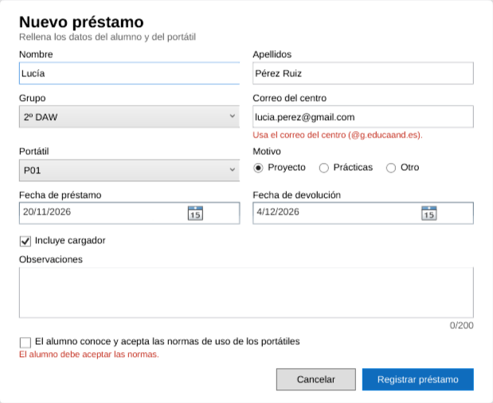
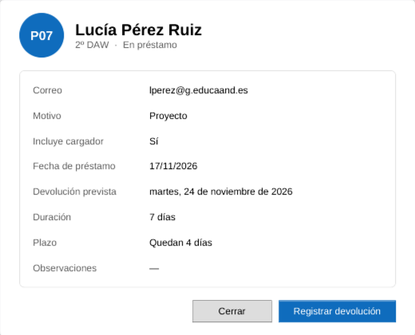

<p align="center"></p>

# 💻 Préstamo de portátiles

**Práctica resumen de la UD01** (*Generación de interfaces de usuario con editores visuales*): aplicación de escritorio WPF (C#) para que el departamento de Informática del IES Gran Capitán lleve el control de los portátiles que presta al alumnado.

Tiene **tres ventanas**: la principal con la lista de préstamos, un formulario para registrar uno nuevo y un detalle desde el que se anota la devolución. Las clases de datos (`Datos/`) venían dadas y no se han modificado; el trabajo es la interfaz, los estilos y los eventos.

## ✨ Funciones

- Lista de préstamos con **filtro** (Todos, En préstamo, Vencidos, Devueltos) y barra de estado con los préstamos en curso, los vencidos y los portátiles disponibles.
- **Nuevo préstamo** con ocho campos y validación completa: el mensaje de error aparece bajo cada campo incorrecto, el foco va al primero y el mensaje desaparece en cuanto se corrige.
- Calendario de devolución **encadenado** al de préstamo (entre el día siguiente y 14 días después) y contador de caracteres de las observaciones (obligatorias si el motivo es «Otro»).
- **Detalle** del préstamo con todos los datos enlazados desde el XAML (`Binding` con `StringFormat`, fechas en español) y botón para **registrar la devolución**, con confirmación.
- Doble clic en la lista para abrir el detalle.
- Al cerrar la aplicación avisa si hay préstamos **vencidos** pendientes.
- Los datos se conservan al cerrar.

## 🚀 Ejecución

Necesitas el **SDK de .NET 10**.

```bash
dotnet run
```

> 🪟 El proyecto usa el SDK estándar (`Microsoft.NET.Sdk`), así que se ejecuta con WPF nativo en Windows. También se puede abrir `PrestamosGC.csproj` en Visual Studio y pulsar F5.
>
> 🐧 Para ejecutarlo en Linux, cambia en `PrestamosGC.csproj` el atributo `Sdk` por `LibreWPF.Sdk/0.1.0-preview.45`, como en la [calculadora](../01_Calculadora/Calculadora.csproj). El XAML y el C# no cambian.

## 🗄️ Datos

Los préstamos se guardan en `prestamos.json`, dentro de `%LocalAppData%\PrestamosGC\` (Windows) o `~/.local/share/PrestamosGC/` (Linux). La primera vez se crean cuatro préstamos de ejemplo: uno en préstamo, uno vencido, uno devuelto y uno que empieza hoy. Para volver a ellos, borra ese archivo.

## 📸 Capturas

| Ventana principal | Formulario con errores | Detalle |
|---|---|---|
|  |  |  |

## ⚙️ Cómo funciona

| Evento | Control | Qué hace |
|---|---|---|
| `Filtro_Checked` | Los cuatro `RadioButton` | Un único manejador: recarga la lista según el filtro y actualiza la barra de estado. |
| `lstPrestamos_SelectionChanged` | `ListBox` | Activa *Ver detalle* solo si hay un préstamo seleccionado. |
| `btnNuevo_Click` | *Nuevo préstamo* | Abre el formulario como ventana modal; si devuelve `true`, recarga la lista y selecciona el préstamo nuevo. |
| `btnDetalle_Click` / `lstPrestamos_MouseDoubleClick` | *Ver detalle* / doble clic | Abre el detalle como ventana modal; si devuelve `true`, recarga la lista. |
| `Window_Closing` | Ventana principal | Si hay vencidos, pregunta antes de salir y cancela el cierre con `e.Cancel`. |
| `dpPrestamo_SelectedDateChanged` | Fecha de préstamo | Limita el calendario de devolución y borra la fecha elegida si queda fuera. |
| `txtObservaciones_TextChanged` | Observaciones | Actualiza el contador (`37/200`). |
| `Motivo_Checked` | Los tres `RadioButton` del motivo | Con «Otro», la etiqueta pasa a «Observaciones (obligatorias)». |
| `Registrar_Click` | *Registrar préstamo* | Valida, crea el `Prestamo` y llama a `InsertarPrestamo`; muestra en `txtErrorGeneral` la `InvalidOperationException` si el portátil o el alumno ya tienen un préstamo. |
| `Devolucion_Click` | *Registrar devolución* | Pide confirmación (Sí/No), llama a `RegistrarDevolucion` y cierra con `DialogResult = true`. |

### ✅ Reglas de validación

| Campo | Regla |
|---|---|
| Nombre y apellidos | Obligatorios |
| Grupo | Elegir uno de los seis (1º/2º DAM, DAW o ASIR) |
| Correo | Formato válido (`MailAddress.TryCreate`) y terminado en `@g.educaand.es` |
| Portátil | Elegir uno de los disponibles |
| Motivo | Proyecto, Prácticas u Otro |
| Fechas | Préstamo no anterior a hoy; devolución entre 1 y 14 días después |
| Observaciones | Hasta 200 caracteres; obligatorias si el motivo es «Otro» |
| Normas de uso | Tienen que estar aceptadas |

### 🎨 Estilos

Los colores y estilos repetidos viven en `App.xaml`: pinceles (`ColorPrincipal`, `ColorError`…), estilos implícitos de `TextBox`, `ComboBox`, `DatePicker` y `Button`, y los estilos con clave `Etiqueta`, `MensajeError`, `BotonPrincipal`, `Tarjeta`, `DetalleTitulo` y `DetalleValor`. Las ventanas no escriben ningún color: usan `StaticResource`.

## 🧩 Estructura

| Archivo | Responsabilidad |
|---|---|
| `App.xaml` / `.cs` | Arranque, pinceles y estilos comunes; almacén compartido `App.Prestamos` |
| `VentanaPrincipal.xaml` / `.cs` | Lista, filtros, barra de estado y navegación |
| `VentanaPrestamo.xaml` / `.cs` | Formulario, validación y eventos encadenados |
| `VentanaDetalle.xaml` / `.cs` | Detalle con `Binding` y devolución |
| `Datos/Prestamo.cs`, `Datos/GestorPrestamos.cs` | Datos y almacén JSON (proporcionados, sin modificar) |
| `Recursos/portatil.png` | Icono de la aplicación |
| `PrestamosGC.csproj` | Configuración del proyecto (.NET 10, WPF) |

## ⚠️ Limitaciones conocidas

- «En préstamo» en el filtro muestra solo los no vencidos, para que coincida con la barra de estado; los vencidos tienen su propio filtro.
- Se comprobó el recorrido completo con una prueba automática en LibreWPF (Linux), pero **no** se ha probado con clics reales ni con WPF nativo en Windows.

## 🧰 Tecnologías

- C# / .NET 10
- WPF y XAML (`Grid`, `StackPanel`, `ListBox`, `ComboBox`, `DatePicker`, `RadioButton`, `CheckBox`)
- `Binding`, estilos y recursos de aplicación, ventanas modales con `DialogResult`
- Almacenamiento en JSON (`System.Text.Json`)
