<p align="center"></p>

# Control del ratón

Ejercicio de clase de la UD01 (WPF).

## 📁 Contenido

- `App.xaml`
- `EventosRaton.csproj`
- `MainWindow.xaml`
- `MainWindow.xaml.cs`

## 🚀 Ejecución

```bash
dotnet run
```
