<p align="center"></p>

# Primera ventana

**Actividad 2.2** de la presentación de la UD01 · Parte 2 (WPF): *Tu primera ventana*.

## 📝 Qué pide la actividad

1. ✅ Proyecto `PrimeraVentana` con .NET 10.
2. ✅ `Title` = «Primera ventana» y tamaño 400 × 250 (`MainWindow.xaml`).
3. ✅ Se ejecuta con `dotnet run` (F5 en Visual Studio).
4. ➖ Recarga activa: se prueba en Visual Studio cambiando el título con la app abierta; no aplica a `dotnet run`.

## 📁 Contenido

- `PrimeraVentana/App.xaml`
- `PrimeraVentana/App.xaml.cs`
- `PrimeraVentana/MainWindow.xaml`
- `PrimeraVentana/MainWindow.xaml.cs`
- `PrimeraVentana/PrimeraVentana.csproj`

## 🚀 Ejecución

```bash
cd PrimeraVentana
dotnet run
```

> 🐧 Usa `LibreWPF.Sdk` (preview) para ejecutarse en Linux. En Windows cambia el `Sdk` del `.csproj` por `Microsoft.NET.Sdk`.
