<p align="center"></p>

# Mini editor de texto

**Actividad 2.5 (B)** de la presentación de la UD01 · Parte 2 (WPF): *Mini editor de texto*.

## 📝 Qué pide la actividad

1. ✅ `DockPanel` con `Menu`, `ToolBar` y `StatusBar`.
2. ✅ `TextBox` multilínea en el centro.
3. ✅ Cortar, Copiar y Pegar con los comandos estándar `ApplicationCommands` (menú y barra comparten comando y se habilitan solos).
4. ✅ La barra de estado muestra el número de caracteres (`Text.Length` enlazado).

## 📁 Contenido

- `MiniEditor/App.xaml`
- `MiniEditor/App.xaml.cs`
- `MiniEditor/MainWindow.xaml`
- `MiniEditor/MainWindow.xaml.cs`
- `MiniEditor/MiniEditor.csproj`

## 🚀 Ejecución

```bash
cd MiniEditor
dotnet run
```

> 🐧 Usa `LibreWPF.Sdk` (preview) para ejecutarse en Linux. En Windows cambia el `Sdk` del `.csproj` por `Microsoft.NET.Sdk`.
