<p align="center"></p>

# Estilo del formulario

**Actividad 2.8** de la presentación de la UD01 · Parte 2 (WPF): *Dale estilo a tu formulario*.

## 📝 Qué pide la actividad

1. ✅ `ThemeMode="System"` en `App.xaml`.
2. ✅ Colores y márgenes como recursos en `App.xaml`; ninguno repetido a mano en la ventana.
3. ✅ Estilo `Primario` para el botón principal (con estados *hover* y deshabilitado).
4. ✅ `DataTemplate` para la lista de la actividad 2.7.

> ⚠️ **Claro y oscuro:** el diseño usa solo colores del tema (salvo el azul de acento definido una vez), pero en `LibreWPF` (el SDK para Linux) `ThemeMode` no cambia el aspecto, así que el criterio «se ve bien en claro y oscuro» **no se ha podido comprobar**. Pruébalo en Windows con el SDK `Microsoft.NET.Sdk`.

## 📁 Contenido

- `EstiloFormulario/Anotacion.cs`
- `EstiloFormulario/App.xaml`
- `EstiloFormulario/App.xaml.cs`
- `EstiloFormulario/EstiloFormulario.csproj`
- `EstiloFormulario/FormularioViewModel.cs`
- `EstiloFormulario/MainWindow.xaml`
- `EstiloFormulario/MainWindow.xaml.cs`

## 🚀 Ejecución

```bash
cd EstiloFormulario
dotnet run
```

> 🐧 Usa `LibreWPF.Sdk` (preview) para ejecutarse en Linux. En Windows cambia el `Sdk` del `.csproj` por `Microsoft.NET.Sdk`.
