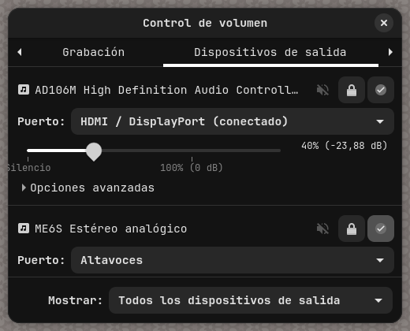
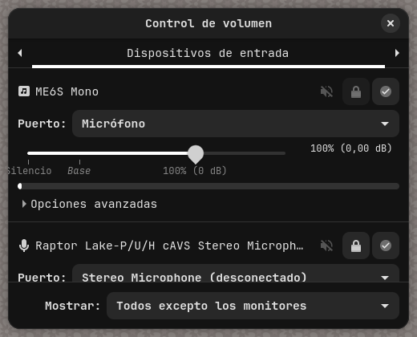
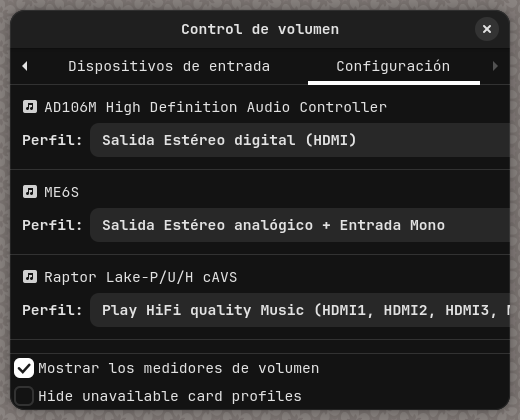

# Actividad 1.3 · Laboratorio de usabilidad

Auditoría de usabilidad de una aplicación de escritorio con carencias reales: **Control de volumen** (`pavucontrol`, GTK) en Arch Linux. Actividad 1.3 de la presentación de la UD01 (parte 1).

> ⚠️ **Estado:** la auditoría (puntos 3 y 4) está hecha y se puede comprobar con las capturas. El **test de tareas con un compañero (punto 2) está sin hacer**: necesita a una persona real y no se inventan tiempos. Las notas son la valoración de un solo auditor; conviene contrastarlas con la pareja de la actividad.

## 1. Aplicación elegida

`pavucontrol` es la interfaz gráfica de PulseAudio/PipeWire. Se eligió porque lo usa casi cualquiera que quiera cambiar de altavoces a auriculares y, aun así, muestra nombres técnicos de hardware y botones solo con icono.

| Captura | Pantalla |
|:--|:--|
| Nº 1 | Dispositivos de salida |
| Nº 2 | Dispositivos de entrada |
| Nº 3 | Configuración |

  
  
  

## 2. Test de tareas (pendiente con un compañero)

Elegir a alguien que **no conozca la aplicación**, cronometrar y anotar errores y dudas.

| Tarea | Tiempo | Errores | Dudas |
|:--|:--:|:--:|:--|
| T1. Bajar el volumen de los altavoces al 20 % | _por medir_ | _por medir_ | _por anotar_ |
| T2. Cambiar la salida de sonido a otro dispositivo | _por medir_ | _por medir_ | _por anotar_ |
| T3. Silenciar el micrófono | _por medir_ | _por medir_ | _por anotar_ |

Recorrido esperable de **T2** según la interfaz (no medido): abrir la app → ir a la pestaña «Dispositivos de salida» (puede exigir desplazar las pestañas con las flechas) → pulsar el icono de check del dispositivo deseado. Ese icono no lleva texto.

## 3. Auditoría con la plantilla (7 criterios, 0–5)

| Criterio | Evidencia | Nota | Observación |
|:--|:--:|:--:|:--|
| Conocer al usuario | capturas 1 y 3 | **2** / 5 | Nombres de hardware en vez de nombres comprensibles: «AD106M High Definition Audio Controller», «Raptor Lake-P/U/H cAVS». |
| Minimizar la memorización | captura 1 | **2** / 5 | Candado, silencio y «predeterminado» son solo iconos; hay que recordar qué hace cada uno. |
| Operaciones frecuentes rápidas | capturas 1 y 2 | **3** / 5 | Ajustar volumen es un deslizador directo, pero cambiar de dispositivo exige cambiar de pestaña y pulsar un check sin etiqueta. |
| Errores y deshacer | capturas 1 y 3 | **3** / 5 | Cambiar de perfil o puerto no muestra aviso ni opción de deshacer. No se ha provocado un error real para comprobar más. |
| Respuesta y estado | capturas 1 y 2 | **4** / 5 | El deslizador muestra porcentaje y dB; los puertos indican «(conectado)» o «(desconectado)». |
| Etiquetado y atajos | capturas 1 y 3 | **2** / 5 | Textos cortados con «…» («Audio Controll…», «Play HiFi quality Music (HDMI1, HDMI2, HDMI3, …»), pestañas ocultas tras flechas y mezcla de idiomas («Hide unavailable card profiles» entre textos en español). Los atajos de teclado no se han comprobado. |
| Ayuda y accesibilidad | capturas 1 y 2 | **3** / 5 | Los marcadores «Silencio», «Base» y «100 %» son pequeños y de poco contraste. No se ha probado el manejo solo con teclado ni con lector de pantalla, y no hay botón de ayuda visible. |

**Nota global:** (2 + 2 + 3 + 3 + 4 + 2 + 3) / 7 = **2,7 / 5**.

**Los dos problemas con peor nota** (base de las conclusiones): *Conocer al usuario* y *Etiquetado y atajos*, empatados a 2 con *Minimizar la memorización*.

## 4. Contraste con la guía del sistema (GNOME HIG)

Aplicación GTK en Linux: se toma la [GNOME Human Interface Guidelines](https://developer.gnome.org/hig/) como guía de referencia. Tres incumplimientos concretos:

1. **Lenguaje familiar para el usuario.** [Writing Style](https://developer.gnome.org/hig/guidelines/writing-style.html) pide «words, phrases, and concepts that are familiar to the people who will be using your app». Nombres como «Raptor Lake-P/U/H cAVS» son del fabricante, no del usuario (capturas 1 y 3).
2. **Texto conciso pero que no pierda el sentido.** La misma guía dice que una etiqueta clara de tres palabras es mejor que una ambigua de una; aquí el perfil «Play HiFi quality Music (HDMI1, HDMI2, HDMI3, …» queda cortado y no se entiende (captura 3).
3. **No depender de tooltips para lo esencial.** [Tooltips](https://developer.gnome.org/hig/patterns/feedback/tooltips.html): «Don't rely on tooltips to communicate essential information». Qué dispositivo es el predeterminado se indica con un check sin texto (capturas 1 y 2). No se ha comprobado si esos botones tienen tooltip.

## 5. Conclusiones

- Lo más urgente es **sustituir los nombres técnicos por nombres de uso** («Altavoces», «Auriculares», «HDMI») y mostrar completos los textos largos.
- Los botones de icono necesitan **etiqueta visible** o al menos tooltip, sobre todo el de «dispositivo predeterminado».
- Pendiente: hacer el test de tareas con un compañero y revisar las notas con él antes de entregar el informe de una página.

## 📁 Contenido

- `docs/capturas/`: las tres capturas usadas como evidencia, tomadas en un compositor aislado (weston) para no capturar el resto del escritorio.
