<p align="center"></p>

# ⚙️ PSP · Programación de Servicios y Procesos

**Ejercicios en Java del módulo de PSP: de la lógica básica de consola a la creación y comunicación de procesos.**

Tres proyectos Maven independientes. Cada uno se abre y se ejecuta por separado.

## 🗂️ Contenido

| Proyecto | Qué trabaja |
|---|---|
| [`01-PruebaInicial`](01-PruebaInicial) | Prueba inicial con 4 ejercicios de consola: calculadora de las cuatro operaciones, comprobación de palíndromos, juego del ahorcado y gestión de alumnos y notas (clases `Alumno` y `Asignatura`). |
| [`02-CadenasAleatorias`](02-CadenasAleatorias) | `Generador` lanza 10 o más procesos hijos de `Cadenas` con `ProcessBuilder`, recoge su salida con `getInputStream()` y comprueba su código de salida con `waitFor()`. |
| [`03-Programacion-Multiproceso`](03-Programacion-Multiproceso) | Dos ejercicios padre/hijo: uno pasa dos arrays como argumentos al proceso hijo y otro le envía datos de alumnos redirigiendo su entrada, su salida y su error a ficheros (`src/main/resources`). |

## 🚀 Ejecución

Necesitas **JDK 26** y **Maven**. Desde la carpeta de un proyecto:

```bash
mvn -q compile
```

Cada proyecto tiene sus clases `main` en `src/main/java`. Por ejemplo, para la prueba inicial:

```bash
java -cp target/classes ejercicios.Ejercicio1
```

> En los proyectos 02 y 03 el padre lanza al hijo con su mismo *classpath*, así que hay que ejecutarlo con `-cp target/classes`. El ejercicio 2 de `03-Programacion-Multiproceso` recibe como argumentos los ficheros de entrada.

## 🧰 Tecnologías

- Java 26 · Maven
- `ProcessBuilder`, `Process` y redirección de flujos
