# 🚀 Proyecto Intermodular

**Actividades del módulo de Proyecto Intermodular del ciclo DAM.**

## 🗂️ Contenido

| Carpeta | Qué contiene |
|---|---|
| [`01-Investigacion_Sector`](01-Investigacion_Sector/README.md) | Investigación del sector IT: estado tecnológico de 8 empresas (RA1a), mapa organizativo sectorial (RA1b) y análisis de roles y funciones (RA1c). Cada entrega está en PDF. |

## 🧰 Tecnologías

- Markdown
- LaTeX para los informes en PDF
