<p align="center"></p>

# 🐍 Python · Programación e Inteligencia Artificial

**Actividades resueltas de las tres primeras unidades de Python, más una mini librería de utilidades con sus pruebas.**

Cada actividad es un script independiente con su enunciado comentado al principio.

## 🗂️ Contenido

| Carpeta | Tema | Actividades |
|---|---|:--:|
| [`01-Introduccion-a-Python`](01-Introduccion-a-Python/ejercicios) | Entorno, tipos, operadores, entrada/salida y depuración | 19 |
| [`02-Control-flujo-estructura-datos`](02-Control-flujo-estructura-datos/ejercicios) | Condicionales, bucles, listas, diccionarios y funciones | 42 |
| [`03-Archivos-errores-modularizacion`](03-Archivos-errores-modularizacion/ejercicios) | Lectura y escritura de ficheros, excepciones y módulos | 17 |
| [`Examen_UD2`](Examen_UD2) | Examen de la unidad 2 (2 ejercicios) | 2 |
| [`utilidades`](utilidades) | Paquete `ficheros` con funciones reutilizables de rutas y ficheros | — |
| [`pruebas`](pruebas) | Pruebas de `utilidades` | — |

## 🚀 Ejecución

Necesitas **Python 3.10 o superior**; no hay dependencias externas.

```bash
python3 01-Introduccion-a-Python/ejercicios/a1_hola_entorno.py
```

Algunos ejercicios piden datos por teclado.

## 🧪 Pruebas

Las pruebas usan solo `unittest` de la librería estándar:

```bash
python3 -m unittest discover -s pruebas -v
```

## 🧰 Tecnologías

- Python 3 · `os`, `unittest`
