<p align="center"></p>

# Introducción a Python

Actividades de la UD01: introducción a Python y su entorno.

## 📁 Contenido

- `Ejercicios/`
- `Ficha_Tecnica_Bitacora_Alumnado_1.md`
- `UD01_Introduccion_a_Python.zip`

## 🚀 Ejecución

```bash
python3 Ejercicios/a1_hola_entorno.py
```
