<p align="center"></p>

# Caso práctico 1 · Odoo

Caso práctico: Odoo con Docker Compose e informe en LaTeX.

## 📁 Contenido

- `Caso_Practico_2_1.pdf`
- `capturas/`
- `docker-compose.yaml`
- `informe.aux`
- `informe.fdb_latexmk`
- `informe.fls`
- `informe.listing`
- `informe.log`
- `informe.out`
- `informe.tex`
- `informe.toc`
- `pre.tex`

## 🚀 Ejecución

```bash
docker compose up -d
```
