<p align="center"></p>

# 🏢 Sistemas de Gestión Empresarial

**Despliegue de sistemas ERP con Docker: guía de referencia y el primer caso práctico con Odoo.**

## 🗂️ Contenido

| Carpeta | Qué contiene |
|---|---|
| [`01_ConfiguracionDocker`](01_ConfiguracionDocker) | [Guía completa de Docker y Docker Compose en Arch Linux](01_ConfiguracionDocker/GuiaCompletaDockerCompose.md): conceptos, instalación, imágenes, volúmenes, redes, Compose, ejemplos con Odoo + PostgreSQL y Spring Boot + PostgreSQL, seguridad y solución de problemas. |
| [`02_CasoPractico1_Odoo_VM`](02_CasoPractico1_Odoo_VM) | Manual de instalación y configuración de **Odoo 20 en una máquina virtual** (Ubuntu 26.04, Docker Compose, Odoo 20.0 y PostgreSQL 16), en [PDF](02_CasoPractico1_Odoo_VM/caso-Practico-2-1.pdf) de 12 páginas. |

## 🚀 Uso

La guía se lee como Markdown. Está probada con Docker 29.9 y Docker Compose 5.6 en Arch Linux. El daemon de Docker no arranca solo:

```bash
sudo systemctl start docker
```

## 🧰 Tecnologías

- Docker · Docker Compose
- Odoo · PostgreSQL
